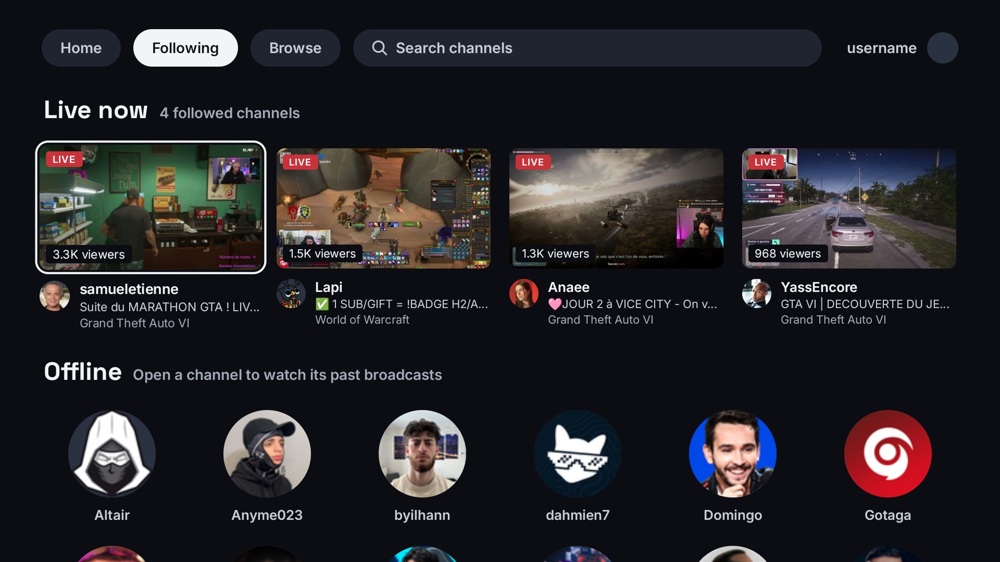

# Twitch Lite for Android TV

The world is shitty, let's make it a little less shitty, starting with a well-made Twitch app. No bloat, no lag, user friendly at every level.

A replacement for the official Twitch app on Android TV and Chromecast with Google TV, written in Kotlin with Jetpack Compose and Media3 ExoPlayer.



## Features

- **Sign-in with a code**: open twitch.tv/activate on a phone, type the code shown on the TV (or scan the QR code).
- **Home**: past broadcasts to continue, live channels you follow, and the most watched streams in your language and in the categories you watch.
- **Following**: your live channels, then the offline ones with their past broadcasts.
- **Browse**: the most watched categories and their live channels, in French or in every language.
- **Search**: channels by name, live ones and offline ones apart.
- **Live streams without ads**, with quality selection.
- **Past broadcasts, sub-only ones included**, with seeking and a progress bar on every thumbnail.
- **Watch progress synced with Twitch**: start a broadcast on the TV, continue on a computer, and the other way round.
- **Chat** beside the video, live or replayed in step with a past broadcast. Read-only, emotes shown as text.

## Install

You need a JDK (17 or later) and the Android SDK with platform 35. The TV must run Android 8 or later.

1. On the TV, turn on Settings › System › Developer options › Wireless debugging.
2. Pair it once with the computer: `adb pair <ip>:<port>`, with the code the TV shows.
3. Build, install and launch:

```sh
scripts/install-tv.sh
```

The script finds the TV on the local network. To target a given device, pass its adb serial: `scripts/install-tv.sh <serial>`.

## Remote control in the player

| Key | Live stream | Past broadcast |
| --- | --- | --- |
| Any key | Shows the controls | Shows the controls |
| Left / Right | Moves between buttons | Skips 10 seconds; hold to go faster |
| OK | Presses the focused button | Pauses or resumes, with the progress bar focused |
| Play/Pause | Pauses; resumes at the live edge | Pauses or resumes |
| Back | Hides the controls, then leaves | Hides the controls, then leaves |

The controls give access to the channel page (its avatar), the chat and the video quality.

## Development

```sh
./gradlew :app:testDebugUnitTest      # unit tests
./gradlew :app:assembleRelease        # the build installed on the TV
scripts/screenshot.sh                 # retake the screenshot above
```

Install the release build on the TV: debug builds of Compose apps are visibly slower.
